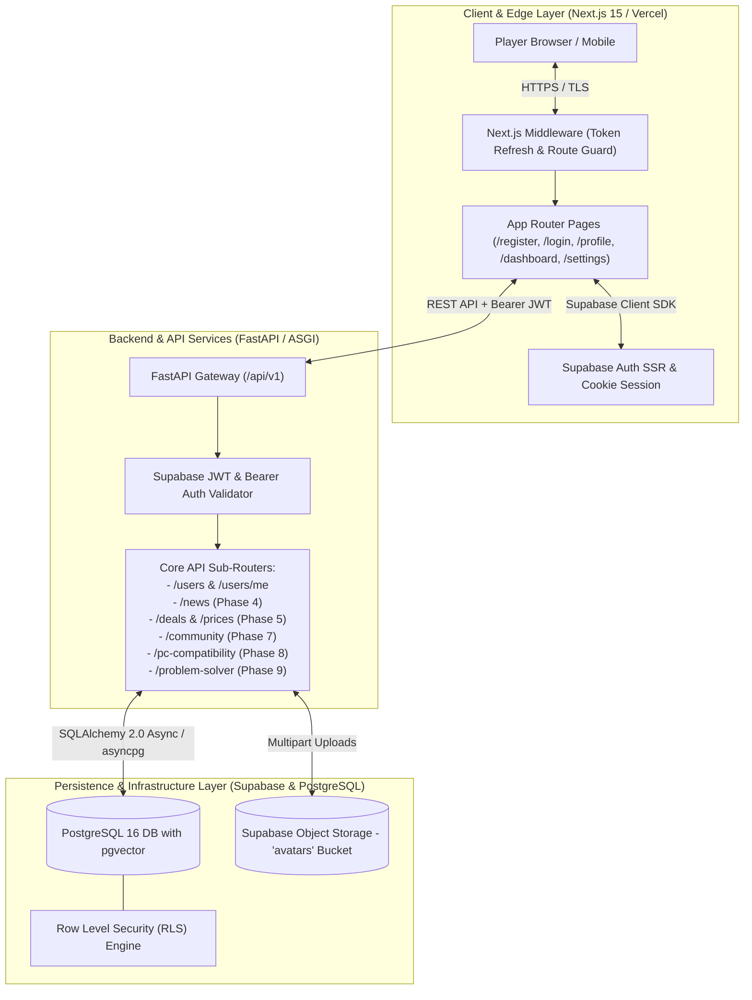
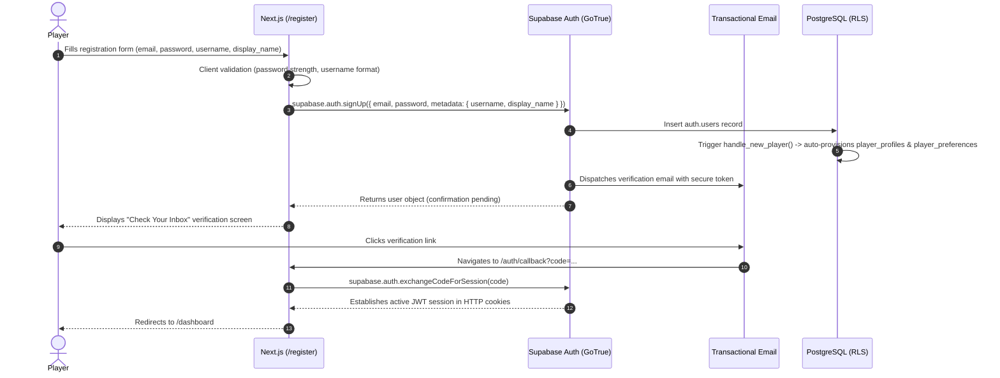
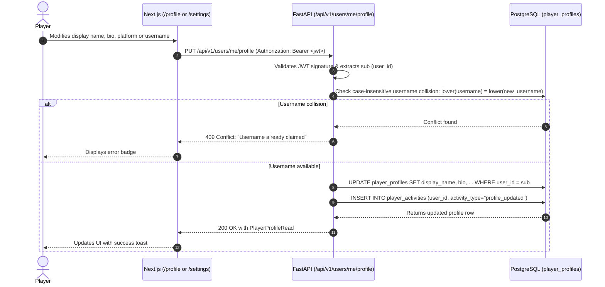

# GTA 6 Player Hub – System Architecture Specification

## 1. High-Level System Architecture

The GTA 6 Player Hub follows a **Decoupled Modular Monolith** topology designed for elastic scalability, robust fault tolerance, and clear boundary isolation.

---

## 2. Authentication & Data Flows

### 2.1 Player Registration & Email Verification Sequence

---

### 2.2 Secure Profile & Preferences Update Flow

---

## 3. Resilience, Caching & Failover Strategies

1. **Dual Driver Database Layer**: Backend utilizes SQLAlchemy 2.0 with `asyncpg` for production PostgreSQL, and seamless in-memory `aiosqlite` during automated tests to guarantee 100% test independence.
2. **Graceful Auth Degradation**: If Supabase credentials are placeholder in development, the frontend falls back to a resilient local test session mode ensuring zero developer friction.
3. **Optimistic UI Updates**: Profile editing and avatar uploads immediately reflect on the client interface while background verification commits changes to the database.
