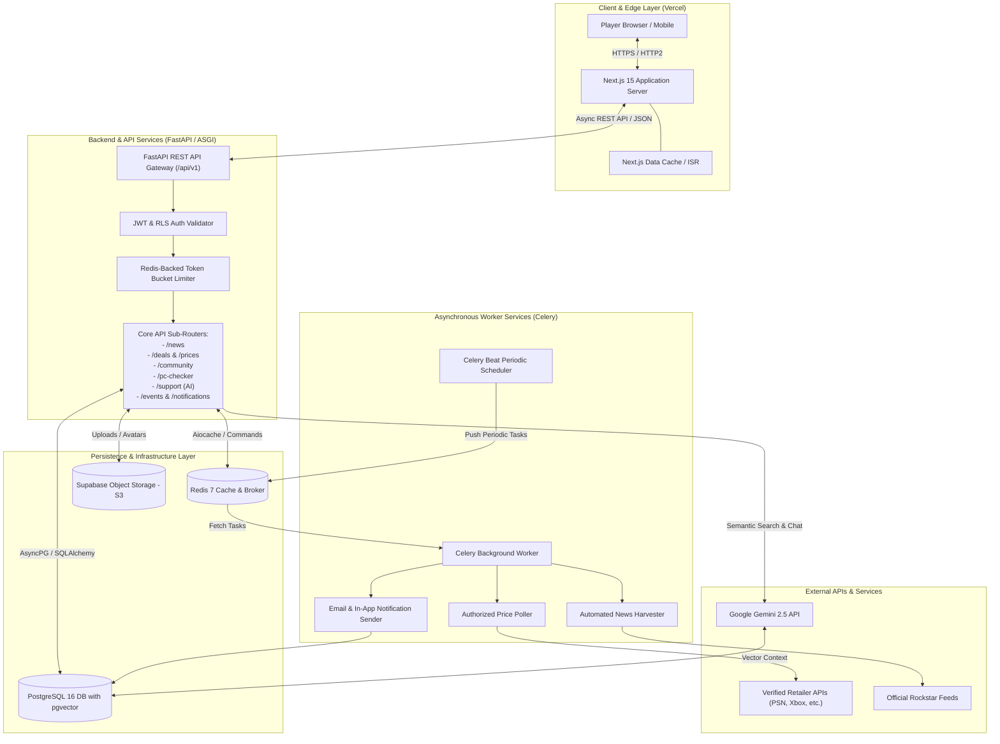
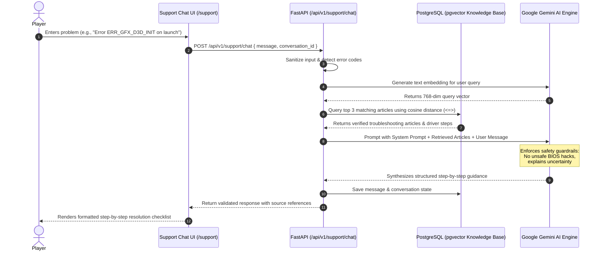
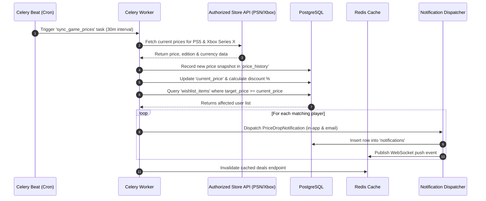

# GTA 6 Player Hub – System Architecture Specification

## 1. High-Level System Architecture

The GTA 6 Player Hub follows a **Decoupled Modular Monolith** topology designed for elastic scalability, robust fault tolerance, and clear boundary isolation.



---

## 2. Component Boundaries & Responsibilities

### 2.1 Frontend Boundary (Next.js 15)
- **Role**: User interface presentation, client state management, responsive rendering, form validation, and server-side cache revalidation.
- **Rendering Modes**:
  - **Incremental Static Regeneration (ISR)**: Used for `/news` articles and `/deals` catalog to deliver sub-100ms response times globally.
  - **Server-Side Rendering (SSR)**: Used for `/dashboard` and `/community` feeds where authentication state dictates personalized views.
  - **Client-Side Rendering (CSR)**: Used for interactive tools such as the PC Compatibility Calculator (`/pc-checker`) and the AI Diagnostic Terminal (`/support`).

### 2.2 Backend Boundary (FastAPI)
- **Role**: Single source of truth for business logic, data persistence, permission verification, and third-party integrations.
- **Security Envelope**: Every request to protected endpoints passes through the `AuthMiddleware` which decodes and validates Supabase JWT signatures and checks user status in PostgreSQL.
- **Uniform Response Protocol**: All responses follow a standardized JSON envelope:
  ```json
  {
    "success": true,
    "data": { ... },
    "error": null,
    "meta": {
      "timestamp": "2026-11-21T12:00:00Z",
      "version": "1.0.0"
    }
  }
  ```

### 2.3 Data Persistence Boundary (PostgreSQL + pgvector)
- **Role**: Relational consistency, transactional safety, and vector embedding similarity queries.
- **Relational Segregation**: Discrete schemas or table namespaces for `auth_profiles`, `news`, `pricing`, `community`, `hardware`, `support`, and `notifications`.
- **Vector Search Engine**: Embedded troubleshooting documentation is stored as 768-dimensional float arrays using `pgvector` with HNSW indexing for rapid cosine similarity retrieval.

### 2.4 Background Worker Boundary (Celery + Redis)
- **Role**: Long-running, periodic, or non-blocking workloads isolated from the web request-response cycle.
- **Queues**:
  - `priority_high`: Instant price drop notifications and security email delivery.
  - `data_sync`: Scheduled price scraping from verified feeds (every 30 minutes).
  - `news_harvester`: Official Rockstar RSS feed polling (every 15 minutes).

---

## 3. Core Data Flow Diagrams

### 3.1 AI Gaming Problem Solver (RAG Pipeline)



---

### 3.2 Price Tracking & Price-Drop Notification Pipeline



---

## 4. Resilience, Caching & Failover Strategies

1. **Stale-While-Revalidate (SWR)**: High-traffic endpoints (`/news`, `/deals`) return cached Redis data while an asynchronous task refreshes the cache in the background.
2. **Circuit Breakers**: External integrations (currency exchange rates, official RSS feeds) are wrapped in circuit breakers with automatic fallback to last-known good states.
3. **Database Connection Pooling**: SQLAlchemy AsyncEngine utilizes a tuned pool of 20 connections with 10 max overflow to maintain low memory overhead under sudden traffic surges.
