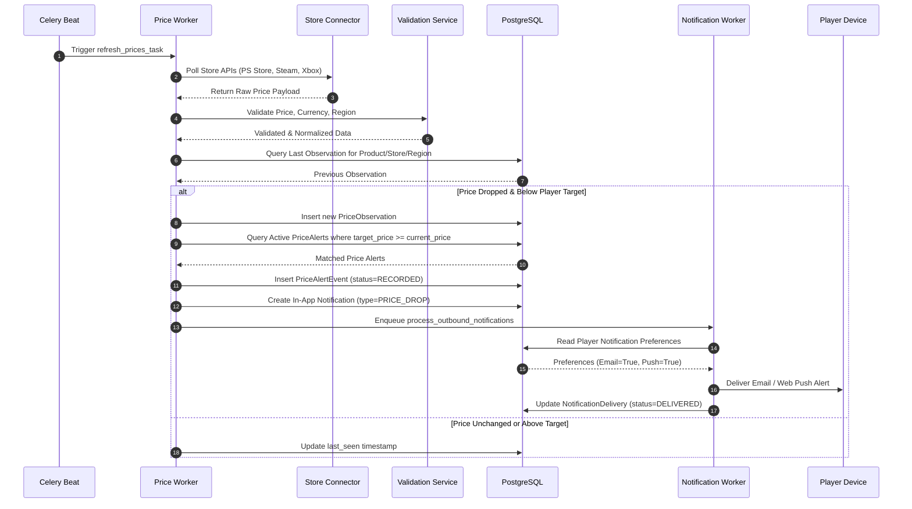

# AUTOMATION ARCHITECTURE: GTA 6 PLAYER HUB
**System Design and Distributed Processing Architecture**
**Version**: 1.0.0 (Phase 10)  
**Status**: Production Ready  

---

## 1. Architectural Principles

The GTA 6 Player Hub automation subsystem is engineered around five fundamental architectural tenets:

1. **Non-Blocking API Ingress**: User-facing web requests handled by the FastAPI application must NEVER perform long-running external API fetches, web crawling, RSS parsing, or bulk email/push transmissions synchronously.
2. **Strict Fault Isolation**: Failures in third-party feeds (such as a timeout on Rockstar Newswire or an unavailable store API) must never cascade into user session failures or degrade site responsiveness.
3. **Idempotence & Deduplication**: All automated ingestion and dispatch jobs can be executed repeatedly without generating duplicate articles, duplicate prices, or redundant player notification alerts.
4. **Data Integrity & Label Preservation**: Collected content is validated against strict domain schemas before database persistence. Verification status tags (`OFFICIAL`, `VERIFIED`, `RUMOUR`, `UNCONFIRMED`) are immutably preserved.
5. **Observability & Auditability**: Every worker invocation, record diff, and third-party response code is logged into structured audit tables for real-time monitoring and post-mortem analysis.

---

## 2. Distributed Architecture Topology

```
+-----------------------------------------------------------------------------------+
|                                 CLIENT TIER                                       |
|  - Next.js 15 Web Application (Desktop / Mobile Browser)                          |
|  - Web Push Service Workers (RFC 8292 Push Notifications)                         |
+------------------------------------------+----------------------------------------+
                                           | HTTPS / JSON
                                           v
+-----------------------------------------------------------------------------------+
|                             FASTAPI INGRESS API                                   |
|  - Authentication & JWT Middleware                                                |
|  - User Data & Personalization Endpoints                                          |
|  - Protected Automation Management & Health Endpoints (/api/v1/automation/*)      |
|  - Event Enqueuing & Immediate Responses                                          |
+-------------------+---------------------------------------+-----------------------+
                    |                                       |
                    | Direct Read/Write                     | Enqueue Tasks
                    v                                       v
+---------------------------------------+   +---------------------------------------+
|          PRIMARY DATABASE             |   |        REDIS MESSAGE BROKER           |
|  - PostgreSQL 15+ (Supabase)          |   |  - DB 0: Application Cache & Sessions |
|  - Connection Pooling (SQLAlchemy)    |   |  - DB 1: Celery Task Queues           |
|  - Row Level Security (RLS)           |   |  - DB 2: Celery Results Backend       |
+-------------------+-------------------+   +-------------------+-------------------+
                    ^                                           |
                    |                                           | Pull Tasks
                    | Write Audited Ingestion & Observations    v
+-------------------+---------------------------------------------------------------+
|                             DISTRIBUTED CELERY WORKERS                            |
|                                                                                   |
|  [Queue: news_queue]         --> collect_news_task, health_check_news             |
|  [Queue: price_queue]        --> refresh_prices_task, check_stale_prices          |
|  [Queue: event_queue]        --> refresh_events_task, process_event_reminders     |
|  [Queue: notification_queue] --> process_email_deliveries, process_push_deliveries|
|  [Queue: ai_queue]           --> maintain_knowledge_base, aggregate_ai_usage     |
|  [Queue: maintenance_queue]  --> check_sources_health, purge_stale_job_logs       |
+---------------------------------------------------------------+-------------------+
                                                                ^
                                                                | Scheduled Triggers
                                            +-------------------+-------------------+
                                            |       CELERY BEAT SCHEDULER           |
                                            |  - Configurable Task Intervals        |
                                            |  - Timezone-Aware UTC Scheduling      |
                                            |  - Health & Deadlock Watchdog         |
                                            +---------------------------------------+
```

---

## 3. Dedicated Task Queues

To guarantee Quality of Service (QoS) and prevent high-volume tasks from starving critical alerts, tasks are partitioned across 6 dedicated queues:

| Queue Name | Routing Key Pattern | Concurrency Profile | Purpose |
|---|---|---|---|
| `news_queue` | `news.*` | Moderate (2-4 workers) | RSS feed retrieval, HTML sanitization, article deduplication |
| `price_queue` | `price.*` | High (4-8 workers) | Store API price polling across 5 regional currencies, discount math |
| `event_queue` | `event.*` | Low (1-2 workers) | Calendar sync, event reschedule detection, reminder dispatch |
| `notification_queue` | `notification.*` | High (4-8 workers) | Outbound SMTP email delivery and Web Push payloads |
| `ai_queue` | `ai.*` | Low (1-2 workers) | Knowledge base vectorization, doc indexing, usage metrics |
| `maintenance_queue` | `maintenance.*` | Low (1 worker) | Source health checks, stale log purging |

---

## 4. End-to-End Processing Flows

### 4.1 Price Drop Alert Flow


---

## 5. Security & Isolation Architecture

1. **Automation Key Protection**: Manual invocation endpoints require a dedicated `X-Automation-Key` header matching `settings.AUTOMATION_API_KEY`.
2. **Network Sandbox & Robots Compliance**:
   - HTTP requests enforce a minimum 15-second connect timeout and a 30-second read timeout.
   - User-Agent strings identify the service (`GTA6PlayerHub-Bot/1.0 (+https://gta6playerhub.com/bot)`).
   - No bypassing of paywalls, CAPTCHAs, or anti-bot defenses is attempted. If a source responds with HTTP 403 or 429, the connector records `DEGRADED` status and enters backoff without retry hammering.
3. **Transactional Safety**:
   - Database writes use explicit transaction boundaries (`session.commit()` on success, `session.rollback()` on exception).
   - Celery async tasks are orchestrated via dedicated session scopes preventing connection pool leaks.
