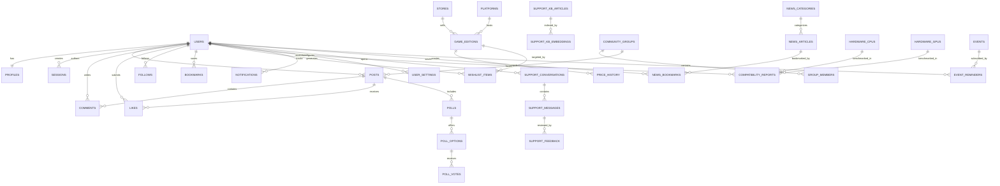

# GTA 6 Player Hub – Database Schema Specification

## 1. Relational Entity Relationship Diagram

The PostgreSQL database architecture is modeled with strict relational integrity, indexed foreign keys, JSONB for flexible telemetry, and `pgvector` for semantic knowledge retrieval.

---

## 2. Table Definitions & Column Specifications

### 2.1 Core Identity & User Management

#### `users` (Managed by Supabase Auth / Local Auth Engine)
- `id` (UUID, Primary Key, default `gen_random_uuid()`)
- `email` (VARCHAR(255), Unique, Not Null)
- `encrypted_password` (VARCHAR(255), Not Null)
- `email_confirmed_at` (TIMESTAMPTZ, Nullable)
- `banned_until` (TIMESTAMPTZ, Nullable)
- `created_at` (TIMESTAMPTZ, Not Null, default `NOW()`)
- `updated_at` (TIMESTAMPTZ, Not Null, default `NOW()`)

#### `profiles`
- `id` (UUID, Primary Key, References `users(id)` ON DELETE CASCADE)
- `username` (VARCHAR(32), Unique, Not Null)
- `display_name` (VARCHAR(64), Not Null)
- `avatar_url` (TEXT, Nullable)
- `bio` (VARCHAR(300), Nullable)
- `country_code` (VARCHAR(3), Nullable, e.g., 'IND', 'USA', 'GBR')
- `preferred_platform` (VARCHAR(20), Not Null, default 'PC') -- 'PC', 'PS5', 'XBOX_SERIES'
- `reputation_score` (INTEGER, Not Null, default 0)
- `is_verified` (BOOLEAN, Not Null, default FALSE)
- `created_at` (TIMESTAMPTZ, Not Null, default `NOW()`)
- `updated_at` (TIMESTAMPTZ, Not Null, default `NOW()`)
- *Indexes*: `CREATE INDEX idx_profiles_username ON profiles(username);`

#### `user_settings`
- `user_id` (UUID, Primary Key, References `users(id)` ON DELETE CASCADE)
- `notify_price_drops` (BOOLEAN, default TRUE)
- `notify_official_news` (BOOLEAN, default TRUE)
- `notify_community_replies` (BOOLEAN, default TRUE)
- `preferred_currency` (VARCHAR(3), default 'INR')
- `email_notifications` (BOOLEAN, default TRUE)
- `theme` (VARCHAR(10), default 'dark')
- `updated_at` (TIMESTAMPTZ, default `NOW()`)

---

### 2.2 News & Official Updates

#### `news_categories`
- `id` (SERIAL, Primary Key)
- `name` (VARCHAR(50), Unique, Not Null) -- e.g., 'Official Announcement', 'Engine & Tech', 'Community Discovery'
- `slug` (VARCHAR(60), Unique, Not Null)

#### `news_articles`
- `id` (UUID, Primary Key, default `gen_random_uuid()`)
- `title` (VARCHAR(255), Not Null)
- `slug` (VARCHAR(280), Unique, Not Null)
- `summary` (TEXT, Not Null)
- `content` (TEXT, Not Null)
- `cover_image_url` (TEXT, Nullable)
- `source_name` (VARCHAR(100), Not Null) -- e.g., 'Rockstar Newswire', 'PlayStation Blog'
- `source_url` (TEXT, Not Null)
- `verification_status` (VARCHAR(20), Not Null) -- 'OFFICIAL', 'VERIFIED', 'RUMOUR', 'UNCONFIRMED'
- `category_id` (INTEGER, References `news_categories(id)`)
- `published_at` (TIMESTAMPTZ, Not Null)
- `is_pinned` (BOOLEAN, default FALSE)
- `view_count` (INTEGER, default 0)
- `created_at` (TIMESTAMPTZ, default `NOW()`)
- *Indexes*: 
  - `CREATE INDEX idx_news_published ON news_articles(published_at DESC);`
  - `CREATE INDEX idx_news_status ON news_articles(verification_status);`
  - Full-Text Search: `CREATE INDEX idx_news_search ON news_articles USING gin(to_tsvector('english', title || ' ' || summary));`

---

### 2.3 Global Price & Deals Tracker

#### `stores`
- `id` (SERIAL, Primary Key)
- `name` (VARCHAR(100), Not Null) -- e.g., 'PlayStation Store', 'Xbox Store', 'Rockstar Store', 'Amazon India'
- `region_code` (VARCHAR(3), Not Null) -- 'IND', 'USA', 'GBR', 'EUR', 'ARE'
- `currency` (VARCHAR(3), Not Null) -- 'INR', 'USD', 'GBP', 'EUR', 'AED'
- `store_url` (TEXT, Not Null)
- `is_authorized` (BOOLEAN, Not Null, default TRUE)

#### `game_editions`
- `id` (SERIAL, Primary Key)
- `store_id` (INTEGER, References `stores(id)` ON DELETE CASCADE)
- `platform` (VARCHAR(20), Not Null) -- 'PS5', 'XBOX_SERIES', 'PC'
- `edition_name` (VARCHAR(50), Not Null) -- 'Standard Edition', 'Deluxe Edition', 'Collector Edition'
- `original_price` (NUMERIC(10, 2), Not Null)
- `current_price` (NUMERIC(10, 2), Not Null)
- `discount_percentage` (INTEGER, default 0)
- `price_inr` (NUMERIC(10, 2), Not Null) -- Normalized for instant global Indian currency comparison
- `is_preorder` (BOOLEAN, default TRUE)
- `product_url` (TEXT, Not Null)
- `last_checked_at` (TIMESTAMPTZ, Not Null, default `NOW()`)
- `deal_expires_at` (TIMESTAMPTZ, Nullable)

#### `price_history`
- `id` (BIGSERIAL, Primary Key)
- `edition_id` (INTEGER, References `game_editions(id)` ON DELETE CASCADE)
- `price` (NUMERIC(10, 2), Not Null)
- `currency` (VARCHAR(3), Not Null)
- `recorded_at` (TIMESTAMPTZ, Not Null, default `NOW()`)
- *Indexes*: `CREATE INDEX idx_price_hist ON price_history(edition_id, recorded_at DESC);`

#### `wishlist_items`
- `id` (UUID, Primary Key, default `gen_random_uuid()`)
- `user_id` (UUID, References `users(id)` ON DELETE CASCADE)
- `edition_id` (INTEGER, References `game_editions(id)` ON DELETE CASCADE)
- `target_price` (NUMERIC(10, 2), Not Null)
- `notify_on_any_drop` (BOOLEAN, default TRUE)
- `created_at` (TIMESTAMPTZ, default `NOW()`)
- *Constraints*: `UNIQUE(user_id, edition_id)`

---

### 2.4 PC Hardware & Compatibility Engine

#### `hardware_cpus`
- `id` (SERIAL, Primary Key)
- `brand` (VARCHAR(20), Not Null) -- 'Intel', 'AMD'
- `model_name` (VARCHAR(100), Unique, Not Null) -- e.g., 'AMD Ryzen 5 7600X'
- `cores` (SMALLINT, Not Null)
- `threads` (SMALLINT, Not Null)
- `base_clock_ghz` (NUMERIC(3, 2), Not Null)
- `boost_clock_ghz` (NUMERIC(3, 2), Not Null)
- `benchmark_score` (INTEGER, Not Null)
- `tier` (VARCHAR(20), Not Null) -- 'Budget', 'Mid-Range', 'High-End', 'Enthusiast'

#### `hardware_gpus`
- `id` (SERIAL, Primary Key)
- `brand` (VARCHAR(20), Not Null) -- 'NVIDIA', 'AMD', 'Intel'
- `model_name` (VARCHAR(100), Unique, Not Null) -- e.g., 'NVIDIA GeForce RTX 4070 Super'
- `vram_gb` (SMALLINT, Not Null)
- `directx_version` (VARCHAR(20), default '12 Ultimate')
- `benchmark_score` (INTEGER, Not Null)
- `tier` (VARCHAR(20), Not Null)

#### `compatibility_reports`
- `id` (UUID, Primary Key, default `gen_random_uuid()`)
- `user_id` (UUID, Nullable, References `users(id)` ON DELETE SET NULL)
- `cpu_id` (INTEGER, References `hardware_cpus(id)`)
- `gpu_id` (INTEGER, References `hardware_gpus(id)`)
- `ram_gb` (SMALLINT, Not Null)
- `storage_type` (VARCHAR(20), Not Null) -- 'NVMe Gen 4', 'NVMe Gen 3', 'SATA SSD', 'HDD'
- `target_resolution` (VARCHAR(10), Not Null) -- '1080p', '1440p', '4K'
- `overall_compatibility_rating` (VARCHAR(30), Not Null) -- 'Meets Expected Modern Triple-A Standard', 'Potential Bottleneck Detected'
- `bottleneck_component` (VARCHAR(50), Nullable)
- `bottleneck_percentage` (INTEGER, default 0)
- `recommendation_summary` (TEXT, Not Null)
- `official_status_disclaimer` (TEXT, Not Null) -- Explicitly: 'GTA VI PC system requirements have not been officially announced by Rockstar Games.'
- `created_at` (TIMESTAMPTZ, default `NOW()`)

---

### 2.5 AI Gaming Problem Solver & Knowledge Base

#### `support_kb_articles`
- `id` (SERIAL, Primary Key)
- `error_code` (VARCHAR(50), Nullable) -- e.g., 'ERR_GFX_D3D_INIT', '0xc0000005'
- `category` (VARCHAR(50), Not Null) -- 'Crash', 'DirectX', 'Driver', 'Black Screen', 'Lag & Stutter', 'Controller'
- `title` (VARCHAR(255), Not Null)
- `symptoms` (TEXT, Not Null)
- `verified_solutions` (JSONB, Not Null) -- Array of numbered steps with warnings
- `safe_flags` (BOOLEAN, default TRUE) -- Verified safe, no risky tweaks
- `updated_at` (TIMESTAMPTZ, default `NOW()`)

#### `support_kb_embeddings` (Requires `pgvector`)
- `id` (SERIAL, Primary Key)
- `article_id` (INTEGER, References `support_kb_articles(id)` ON DELETE CASCADE)
- `content_chunk` (TEXT, Not Null)
- `embedding` (vector(768), Not Null) -- Matches Gemini text-embedding dimensions
- *Indexes*: `CREATE INDEX idx_support_vector ON support_kb_embeddings USING hnsw (embedding vector_cosine_ops);`

#### `support_conversations`
- `id` (UUID, Primary Key, default `gen_random_uuid()`)
- `user_id` (UUID, Nullable, References `users(id)` ON DELETE SET NULL)
- `session_id` (VARCHAR(64), Not Null) -- For unauthenticated guest queries
- `title` (VARCHAR(150), default 'New Troubleshooting Session')
- `created_at` (TIMESTAMPTZ, default `NOW()`)

#### `support_messages`
- `id` (BIGSERIAL, Primary Key)
- `conversation_id` (UUID, References `support_conversations(id)` ON DELETE CASCADE)
- `sender` (VARCHAR(10), Not Null) -- 'user', 'assistant'
- `message_text` (TEXT, Not Null)
- `retrieved_references` (JSONB, Nullable)
- `created_at` (TIMESTAMPTZ, default `NOW()`)

#### `support_feedback`
- `id` (BIGSERIAL, Primary Key)
- `message_id` (BIGINT, References `support_messages(id)` ON DELETE CASCADE)
- `is_helpful` (BOOLEAN, Not Null)
- `feedback_notes` (TEXT, Nullable)
- `created_at` (TIMESTAMPTZ, default `NOW()`)

---

### 2.6 Gaming Community & Moderation

#### `community_groups`
- `id` (SERIAL, Primary Key)
- `name` (VARCHAR(80), Unique, Not Null)
- `slug` (VARCHAR(90), Unique, Not Null)
- `description` (VARCHAR(300), Not Null)
- `icon_url` (TEXT, Nullable)
- `member_count` (INTEGER, default 0)
- `created_at` (TIMESTAMPTZ, default `NOW()`)

#### `posts`
- `id` (UUID, Primary Key, default `gen_random_uuid()`)
- `author_id` (UUID, References `users(id)` ON DELETE CASCADE)
- `group_id` (INTEGER, Nullable, References `community_groups(id)` ON DELETE SET NULL)
- `title` (VARCHAR(200), Not Null)
- `content` (TEXT, Not Null)
- `media_urls` (JSONB, Nullable) -- Array of approved image URLs
- `like_count` (INTEGER, default 0)
- `comment_count` (INTEGER, default 0)
- `is_pinned` (BOOLEAN, default FALSE)
- `is_locked` (BOOLEAN, default FALSE)
- `is_flagged` (BOOLEAN, default FALSE)
- `created_at` (TIMESTAMPTZ, default `NOW()`)
- *Indexes*: `CREATE INDEX idx_posts_author ON posts(author_id); CREATE INDEX idx_posts_created ON posts(created_at DESC);`

#### `comments`
- `id` (UUID, Primary Key, default `gen_random_uuid()`)
- `post_id` (UUID, References `posts(id)` ON DELETE CASCADE)
- `author_id` (UUID, References `users(id)` ON DELETE CASCADE)
- `parent_id` (UUID, Nullable, References `comments(id)` ON DELETE CASCADE) -- Nested replies
- `content` (TEXT, Not Null)
- `like_count` (INTEGER, default 0)
- `created_at` (TIMESTAMPTZ, default `NOW()`)

#### `polls` & `poll_options` & `poll_votes`
- Normalized voting structures ensuring one vote per authenticated player per poll.

#### `content_reports`
- `id` (SERIAL, Primary Key)
- `reporter_id` (UUID, References `users(id)`)
- `target_type` (VARCHAR(20), Not Null) -- 'POST', 'COMMENT', 'USER'
- `target_id` (UUID, Not Null)
- `reason` (VARCHAR(100), Not Null)
- `details` (TEXT, Nullable)
- `status` (VARCHAR(20), default 'PENDING') -- 'PENDING', 'RESOLVED', 'DISMISSED'
- `created_at` (TIMESTAMPTZ, default `NOW()`)

---

### 2.7 Events & Notifications

#### `events`
- `id` (SERIAL, Primary Key)
- `title` (VARCHAR(200), Not Null)
- `slug` (VARCHAR(220), Unique, Not Null)
- `description` (TEXT, Not Null)
- `category` (VARCHAR(50), Not Null) -- 'Trailer Drop', 'Launch Date', 'Earnings Call', 'Gaming Expo'
- `event_time_utc` (TIMESTAMPTZ, Not Null)
- `is_official` (BOOLEAN, default TRUE)
- `source_link` (TEXT, Nullable)

#### `notifications`
- `id` (UUID, Primary Key, default `gen_random_uuid()`)
- `user_id` (UUID, References `users(id)` ON DELETE CASCADE)
- `type` (VARCHAR(50), Not Null) -- 'PRICE_DROP', 'BREAKING_NEWS', 'COMMENT_REPLY', 'EVENT_REMINDER'
- `title` (VARCHAR(200), Not Null)
- `message` (TEXT, Not Null)
- `action_url` (TEXT, Not Null)
- `is_read` (BOOLEAN, default FALSE)
- `created_at` (TIMESTAMPTZ, default `NOW()`)
- *Indexes*: `CREATE INDEX idx_notif_user ON notifications(user_id, is_read, created_at DESC);`
