# GTA 6 Player Hub – Database Schema Specification

## 1. Relational Entity Relationship Diagram

The database architecture is modeled with strict relational integrity, indexed foreign keys, JSONB for flexible telemetry, and `pgvector` for semantic knowledge retrieval.

```mermaid
erDiagram
    AUTH_USERS ||--|| PLAYER_PROFILES : has
    AUTH_USERS ||--|| PLAYER_PREFERENCES : configures
    AUTH_USERS ||--o{ PLAYER_ACTIVITIES : logs
    AUTH_USERS ||--o{ POSTS : authors
    AUTH_USERS ||--o{ COMMENTS : writes
    AUTH_USERS ||--o{ LIKES : submits
    AUTH_USERS ||--o{ FOLLOWS : follows
    AUTH_USERS ||--o{ WISHLIST_ITEMS : tracks
    AUTH_USERS ||--o{ COMPATIBILITY_REPORTS : generates
    AUTH_USERS ||--o{ NOTIFICATIONS : receives

    NEWS_CATEGORIES ||--o{ NEWS_ARTICLES : categorizes
    NEWS_ARTICLES ||--o{ NEWS_BOOKMARKS : bookmarked_by
    AUTH_USERS ||--o{ NEWS_BOOKMARKS : saves

    STORES ||--o{ GAME_EDITIONS : sells
    PLATFORMS ||--o{ GAME_EDITIONS : hosts
    GAME_EDITIONS ||--o{ PRICE_HISTORY : records
    GAME_EDITIONS ||--o{ WISHLIST_ITEMS : targeted_by

    COMMUNITY_GROUPS ||--o{ GROUP_MEMBERS : contains
    COMMUNITY_GROUPS ||--o{ POSTS : hosts
    POSTS ||--o{ COMMENTS : contains
    POSTS ||--o{ LIKES : receives
    POSTS ||--o{ POLLS : includes
    POLLS ||--o{ POLL_OPTIONS : offers
    POLL_OPTIONS ||--o{ POLL_VOTES : receives

    SUPPORT_KB_ARTICLES ||--o{ SUPPORT_KB_EMBEDDINGS : indexed_by
    SUPPORT_CONVERSATIONS ||--o{ SUPPORT_MESSAGES : contains
    SUPPORT_MESSAGES ||--o{ SUPPORT_FEEDBACK : reviewed_by

    HARDWARE_CPUS ||--o{ COMPATIBILITY_REPORTS : benchmarked_in
    HARDWARE_GPUS ||--o{ COMPATIBILITY_REPORTS : benchmarked_in

    EVENTS ||--o{ EVENT_REMINDERS : subscribed_by
    AUTH_USERS ||--o{ EVENT_REMINDERS : creates
```

---

## 2. Implemented Phase 2 Tables

### 2.1 `player_profiles`
Stores public and private profile data for registered GTA 6 players. Linked 1-to-1 with Supabase `auth.users`.

| Column | Type | Constraints | Description |
| :--- | :--- | :--- | :--- |
| `id` | `UUID` / `CHAR(36)` | PRIMARY KEY, Default gen_random_uuid() | Unique profile identifier |
| `user_id` | `UUID` / `CHAR(36)` | UNIQUE, NOT NULL, INDEX, References `auth.users(id)` | Authenticated player ID |
| `username` | `VARCHAR(32)` | UNIQUE, NOT NULL, INDEX | Gamer username (3–30 chars, alphanumeric + `_`) |
| `display_name` | `VARCHAR(64)` | NOT NULL | Public display name |
| `avatar_url` | `VARCHAR(512)` / `TEXT`| NULLABLE | S3 / Supabase storage path or data URI |
| `bio` | `VARCHAR(500)` | NULLABLE | Player biography (max 500 characters) |
| `country_code` | `VARCHAR(3)` | NULLABLE | ISO 3166-1 alpha-3 code (e.g. `USA`, `IND`, `GBR`) |
| `preferred_platform` | `VARCHAR(20)` | NOT NULL, DEFAULT `'PC'` | `'PC'`, `'PS5'`, `'XBOX_SERIES'` |
| `preferred_language` | `VARCHAR(10)` | NOT NULL, DEFAULT `'en'` | UI locale code |
| `profile_visibility` | `VARCHAR(20)` | NOT NULL, DEFAULT `'public'` | `'public'` or `'private'` |
| `reputation_score` | `INTEGER` | NOT NULL, DEFAULT `0` | Community karma and engagement points |
| `is_verified` | `BOOLEAN` | NOT NULL, DEFAULT `FALSE` | Official verified player flag |
| `created_at` | `TIMESTAMPTZ` | NOT NULL, DEFAULT `NOW()` | Profile creation timestamp |
| `updated_at` | `TIMESTAMPTZ` | NOT NULL, DEFAULT `NOW()` | Last modification timestamp |

**Indexes**:
- `CREATE UNIQUE INDEX idx_player_profiles_lower_username ON player_profiles (lower(username));` (Case-insensitive uniqueness)
- `CREATE INDEX idx_player_profiles_user_id ON player_profiles (user_id);`

---

### 2.2 `player_preferences`
Stores regional currency settings, gaming preferences, and notification channels. Linked 1-to-1 with Supabase `auth.users`.

| Column | Type | Constraints | Description |
| :--- | :--- | :--- | :--- |
| `id` | `UUID` / `CHAR(36)` | PRIMARY KEY, Default gen_random_uuid() | Unique preference identifier |
| `user_id` | `UUID` / `CHAR(36)` | UNIQUE, NOT NULL, INDEX, References `auth.users(id)` | Authenticated player ID |
| `preferred_country` | `VARCHAR(3)` | NOT NULL, DEFAULT `'USA'` | User territory |
| `preferred_currency` | `VARCHAR(3)` | NOT NULL, DEFAULT `'USD'` | Preferred currency (`USD`, `INR`, `EUR`, `GBP`, `AED`) |
| `preferred_platform` | `VARCHAR(20)` | NOT NULL, DEFAULT `'PC'` | Default platform for deals |
| `preferred_edition` | `VARCHAR(50)` | NOT NULL, DEFAULT `'Standard Edition'` | Target game edition |
| `preferred_language` | `VARCHAR(10)` | NOT NULL, DEFAULT `'en'` | Interface language |
| `email_notifications` | `BOOLEAN` | NOT NULL, DEFAULT `TRUE` | Master email toggle |
| `push_notifications` | `BOOLEAN` | NOT NULL, DEFAULT `FALSE` | Web push notifications |
| `community_notifications` | `BOOLEAN` | NOT NULL, DEFAULT `TRUE` | Comments and replies alerts |
| `news_notifications` | `BOOLEAN` | NOT NULL, DEFAULT `TRUE` | Breaking news bulletins |
| `price_alert_notifications`| `BOOLEAN` | NOT NULL, DEFAULT `TRUE` | Wishlist price drop alerts |
| `event_notifications` | `BOOLEAN` | NOT NULL, DEFAULT `TRUE` | Event countdown reminders |
| `created_at` | `TIMESTAMPTZ` | NOT NULL, DEFAULT `NOW()` | Timestamp |
| `updated_at` | `TIMESTAMPTZ` | NOT NULL, DEFAULT `NOW()` | Timestamp |

**Indexes**:
- `CREATE INDEX idx_player_preferences_user_id ON player_preferences (user_id);`

---

### 2.3 `player_activities`
Auditable security and profile event logs for account history.

| Column | Type | Constraints | Description |
| :--- | :--- | :--- | :--- |
| `id` | `UUID` / `CHAR(36)` | PRIMARY KEY, Default gen_random_uuid() | Unique activity identifier |
| `user_id` | `UUID` / `CHAR(36)` | NOT NULL, INDEX, References `auth.users(id)` | Authenticated player ID |
| `activity_type` | `VARCHAR(50)` | NOT NULL | Event code (e.g. `account_registered`, `profile_updated`) |
| `description` | `VARCHAR(255)` | NOT NULL | Human-readable activity summary |
| `ip_address` | `VARCHAR(45)` | NULLABLE | Client IP for security logs |
| `user_agent` | `VARCHAR(255)` | NULLABLE | Client browser/OS |
| `created_at` | `TIMESTAMPTZ` | NOT NULL, DEFAULT `NOW()` | Event timestamp |

**Indexes**:
- `CREATE INDEX idx_player_activities_user_id ON player_activities (user_id, created_at DESC);`

---

## 3. Supabase Row Level Security (RLS) Architecture

Row Level Security is enabled on all player tables to enforce strict data isolation at the PostgreSQL layer:

### A. `player_profiles` Policies
- **SELECT**: `profile_visibility = 'public' OR auth.uid() = user_id`
  (Public profiles can be viewed by anyone; private profiles can only be viewed by the owning user).
- **INSERT**: `auth.uid() = user_id`
  (Users can only insert their own profile row).
- **UPDATE**: `auth.uid() = user_id`
  (Users can only update their own profile).
- **DELETE**: `auth.uid() = user_id`
  (Users can only delete their own profile).

### B. `player_preferences` Policies
- **SELECT**: `auth.uid() = user_id` (Private to owning player).
- **INSERT**: `auth.uid() = user_id`.
- **UPDATE**: `auth.uid() = user_id`.
- **DELETE**: `auth.uid() = user_id`.

### C. `player_activities` Policies
- **SELECT**: `auth.uid() = user_id`.
- **INSERT**: `auth.uid() = user_id`.

### D. Supabase Storage `avatars` Policies
- **SELECT**: Public read for all avatars (`bucket_id = 'avatars'`).
- **INSERT**: `bucket_id = 'avatars' AND auth.role() = 'authenticated' AND (storage.foldername(name))[1] = auth.uid()::text`.
- **UPDATE / DELETE**: Restricted to owning user folder.

---

## 4. Planned Future Feature Tables (Distinguished from Phase 2)

The following tables are architecturally designed for upcoming phases:
- **Phase 3 & 4 (News)**: `news_categories`, `news_articles`, `news_bookmarks`.
- **Phase 5 (Prices)**: `stores`, `game_editions`, `price_history`, `wishlist_items`.
- **Phase 6 (Events & Notifications)**: `events`, `event_reminders`, `notifications`.
- **Phase 7 (Community)**: `community_groups`, `group_members`, `posts`, `comments`, `likes`, `polls`, `poll_options`, `poll_votes`.
- **Phase 8 (PC Specs)**: `hardware_cpus`, `hardware_gpus`, `compatibility_reports`.
- **Phase 9 (AI Solver)**: `support_kb_articles`, `support_kb_embeddings` (`pgvector`), `support_conversations`, `support_messages`, `support_feedback`.
