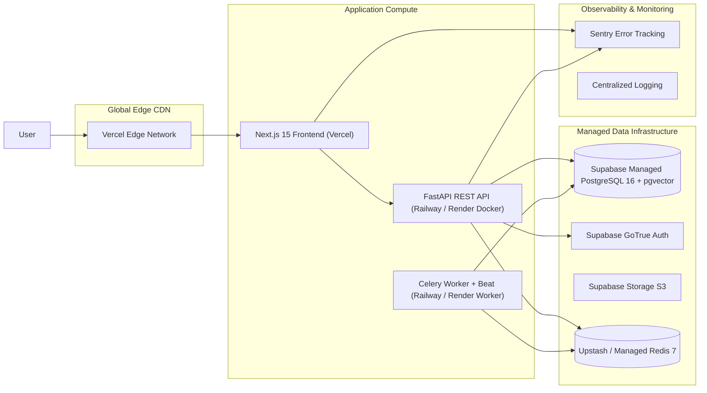

# GTA 6 Player Hub – Deployment & DevOps Architecture

## 1. Production Topology

GTA 6 Player Hub is architected for zero-downtime, continuous deployment utilizing managed cloud platforms optimized for each service layer.



---

## 2. Infrastructure Hosting Matrix

| Tier | Provider | Service | Configuration |
| :--- | :--- | :--- | :--- |
| **Frontend** | Vercel | Next.js Hosting | Edge caching, automated preview deployments, custom domain with managed SSL. |
| **Backend API** | Railway / Render | Docker Web Service | Autoscaling container running Uvicorn ASGI on Python 3.12/3.14. |
| **Async Workers** | Railway / Render | Docker Background Worker | Celery worker and Celery beat process. |
| **Database** | Supabase | Managed PostgreSQL 16 | Dedicated instance with `pgvector` enabled, point-in-time recovery, automated backups. |
| **Cache & Queue**| Upstash / Railway | Managed Redis 7 | Persistent in-memory cache with eviction policies. |
| **Object Storage**| Supabase Storage | S3-compatible | Public and authenticated buckets for community media and avatars. |

---

## 3. Continuous Integration & Continuous Deployment (CI/CD)

Automated GitHub Actions workflows ensure every commit and pull request is validated before deployment.

### `.github/workflows/ci.yml` (Workflow Specification)
```yaml
name: CI Quality Gate

on:
  push:
    branches: [main, develop]
  pull_request:
    branches: [main]

jobs:
  backend-checks:
    runs-on: ubuntu-latest
    steps:
      - uses: actions/checkout@v4
      - name: Set up Python
        uses: actions/setup-python@v5
        with:
          python-version: '3.12'
      - name: Install dependencies
        run: |
          pip install --upgrade pip
          pip install -r backend/requirements.txt
          pip install ruff pytest pytest-cov
      - name: Lint with Ruff
        run: ruff check backend/
      - name: Run Backend Tests
        run: pytest backend/tests --cov=backend/app

  frontend-checks:
    runs-on: ubuntu-latest
    steps:
      - uses: actions/checkout@v4
      - name: Set up Node.js
        uses: actions/setup-node@v4
        with:
          node-version: 20
          cache: 'npm'
          cache-dependency-path: frontend/package-lock.json
      - name: Install dependencies
        run: cd frontend && npm ci
      - name: Typecheck
        run: cd frontend && npx tsc --noEmit
      - name: Run Unit Tests
        run: cd frontend && npm run test
```

---

## 4. Production Health Checks & Zero-Downtime Releases

### Health Check Endpoints
- **Liveness Probe**: `GET /api/v1/health/live` -> Returns HTTP 200 `{ "status": "alive" }`.
- **Readiness Probe**: `GET /api/v1/health/ready` -> Validates active connection to PostgreSQL and Redis. Returns HTTP 503 if any dependency is unreachable.

### Migration Safety
Database migrations are applied via an init container or release phase before routing traffic to new container versions:
```bash
alembic upgrade head
```

---

## 5. Observability, Logging & Incident Management

1. **Error Tracking**: Sentry is integrated into both Next.js (`@sentry/nextjs`) and FastAPI (`sentry-sdk[fastapi]`) to capture uncaught exceptions with full stack traces and breadcrumbs.
2. **Structured Logging**: Backend emits JSON structured logs containing `request_id`, `user_id`, `path`, `status_code`, and `duration_ms`.
3. **Uptime Monitoring**: External synthetic probes verify API health every 60 seconds and trigger incident alerts if latency exceeds 1.5 seconds or status codes are non-200.
