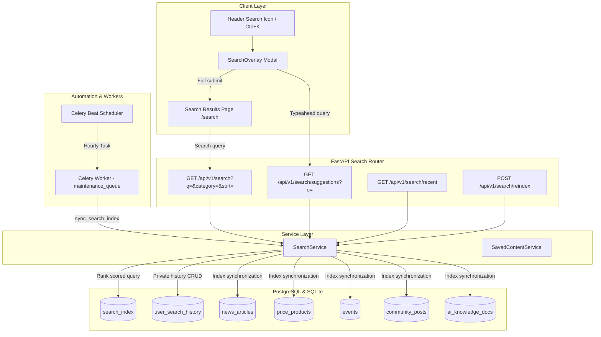

# GLOBAL SEARCH ARCHITECTURE
## GTA 6 Player Hub – Search Engine Architecture & Integration

### 1. Overview & Principles

The Global Search system in GTA 6 Player Hub is designed around four core architectural principles:
1. **Multi-Domain Discovery:** Unifies indexing across 5 disparate entities (News, Products/Deals, Calendar Events, Discussions, and Troubleshooting Guides).
2. **Privacy by Design:** Strict exclusion of private data (such as player hardware profiles, private AI troubleshooting sessions, and blocked community discussions).
3. **Data Integrity:** Verification badges (`OFFICIAL`, `VERIFIED`, `RUMOUR`, `UNCONFIRMED`) and price freshness tags are preserved throughout search results.
4. **Dual-Tier Querying:** Real-time autocomplete suggestions with pre-aggregated counts and rank-scored pagination for comprehensive searches.

---

### 2. High-Level Architecture Diagram

---

### 3. Search Rank Scoring Algorithm

Search ranking in `SearchService.search()` employs a multi-tiered relevance scoring model:
1. **Exact Title Prefix Match:** Highest priority score (+100).
2. **Title Substring Match:** High priority score (+60).
3. **Category Match:** Moderate priority score (+30).
4. **Description / Keyword Match:** Baseline score (+15).
5. **Freshness Weighting:** Bonus points for recent official announcements and upcoming event dates.

When players sort by `price_asc` or `price_desc`, deals items with numerical price observations take precedence. When sorting by `upcoming`, chronological event start dates are computed.

---

### 4. Privacy & Access Control Enforcement

| Content Source | Search Indexing Policy | Access Boundary |
| :--- | :--- | :--- |
| **News Articles** | Indexed with verification tags (`OFFICIAL`, `VERIFIED`, `RUMOUR`, `UNCONFIRMED`). | Publicly accessible. |
| **Price Deals** | Indexed with edition, platform, retailer name, and current price amount. | Publicly accessible. |
| **Calendar Events** | Indexed with official schedule, category, and online stream details. | Publicly accessible. |
| **Community Posts** | Only `PUBLISHED` posts from active (unblocked) players. | Private or deleted content excluded. |
| **PC Hardware Profiles** | **NEVER INDEXED**. Saved hardware specifications are strictly private to player accounts. | Private to profile owner. |
| **AI Problem Solver** | Only approved public knowledge documents. Private player AI conversations are **NEVER INDEXED**. | Confidential to player. |
| **Search History** | Stored per user UUID with strict row-level authorization (`user_id == current_user.id`). | Fully isolated per user. |

---

### 5. Frontend Command Palette & Results Architecture

- **SearchOverlay (`frontend/src/components/search/SearchOverlay.tsx`):**
  - Global event listener for `Ctrl+K`, `Cmd+K`, and `/` triggers.
  - Native custom event dispatching (`gta6:open-search`).
  - Debounced autocomplete via `fetchSearchSuggestions(q, limit)`.
  - Offline localStorage fallback for unauthenticated player recent searches.
- **SearchResultsClient (`frontend/src/components/search/SearchResultsClient.tsx`):**
  - URL parameter synchronization via Next.js `useSearchParams()` and `router.push()`.
  - Dynamic filter pills with counts sourced from `GET /api/v1/search/categories`.
  - Pagination controls preserving query, category, and sorting filters.
