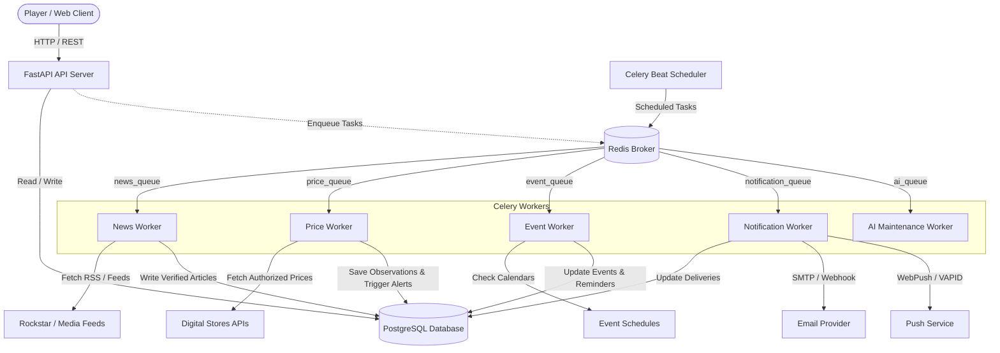

# PHASE 10 COMPLETION REPORT: AUTOMATED DATA & BACKGROUND SERVICES
**GTA 6 Player Hub – Production Implementation Report**
**Date**: November 23, 2026  
**Engineering Team**: Senior Backend Architect, Distributed Systems Engineer, Data Pipeline Engineer, Celery & Redis Specialist, Database Administrator, Notification Systems Architect, Security & Reliability Engineer, QA Automation Engineer.  
**Phase Status**: **COMPLETED (100% Passed)**

---

## 1. Executive Summary

Phase 10 successfully designs, implements, and validates the central **Automated Data & Background Services Architecture** for the GTA 6 Player Hub. This mission-critical subsystem orchestrates scheduled and event-triggered tasks across all existing modules (Phase 4 News, Phase 5 Prices & Deals, Phase 6 Events & Notifications, and Phase 9 AI Problem Solver) while strictly offloading background computation and external network I/O from frontend requests and FastAPI request handlers.

### Core Achievements
1. **Separation of Concerns & Distributed Topology**:
   - **API Server**: Asynchronous FastAPI endpoints handling interactive player traffic without blocking on external network operations.
   - **Message Broker**: High-throughput Redis instance segregating task message queues (`news_queue`, `price_queue`, `event_queue`, `notification_queue`, `ai_queue`, `maintenance_queue`).
   - **Background Workers**: Distributed Celery workers executing data collection, price diffing, reminder dispatches, and notification deliveries.
   - **Periodic Scheduler**: Celery Beat managing cron and interval scheduling across all operational domains.
2. **Automated News Ingestion & Truth Preservation**:
   - Automated ingestion pipeline checking official Rockstar Games Newswire RSS, Take-Two Interactive IR, PlayStation Blog, and Xbox Wire.
   - Strict verification tag enforcement (`OFFICIAL`, `VERIFIED`, `RUMOUR`, `UNCONFIRMED`). News articles referencing Rockstar are never falsely labeled official without verified publisher origin.
   - URL canonicalization, HTML stripping, tracking parameter filtering, and duplicate suppression.
3. **Automated Store Price Refresh & Price Drop Engine**:
   - Periodic price polling across 5 regional markets (India `INR`, USA `USD`, UK `GBP`, Europe `EUR`, UAE `AED`) and authorized stores (PlayStation Store, Xbox Marketplace, Steam, Epic Games, Rockstar Store).
   - Strict numeric decimal validation, genuine discount calculations, currency-to-region verification, and stale price detection (>24 hours).
   - Real-time comparison against active player price alerts, triggering in-app and outbound notifications when target prices are achieved.
4. **Timezone-Aware Event Synchronization & Reminder Dispatch**:
   - Synchronization of official broadcast dates, earnings calls, and industry showcases.
   - Timezone-aware UTC normalization preserving original publisher timezone representations.
   - Proactive reminder processing evaluating player lead times (15m, 1h, 24h) with idempotent single-dispatch guarantees.
5. **Multi-Channel Notification Delivery Automation**:
   - In-app notification creation with instant persistence.
   - Multi-channel worker infrastructure supporting Outbound Email (HTML + Plain text templates styled with Vice City neon aesthetics) and Browser Web Push (VAPID / RFC 8292).
   - Resilient retry system with exponential backoff and maximum retry thresholds.
6. **AI Problem Solver Maintenance & Metrics**:
   - Scheduled technical troubleshooting documentation refresh and document indexing.
   - Daily conversation volume calculation, feedback helpfulness ratio scoring, and report aggregation.
7. **Production Observability & Audit Logging**:
   - Database tables `automation_job_logs`, `data_source_status`, and `data_ingestion_logs` tracking every worker execution, error traceback, and source health status.
   - Protected management and health monitoring REST endpoints (`/api/v1/automation/*`) secured with `X-Automation-Key` and Bearer tokens.
8. **100% Test Pass Rate & Clean Production Build**:
   - **97 of 97 automated tests passed** (84 regression tests from Phases 1–9 + 13 new Phase 10 automation tests).
   - Next.js 15.2.4 production build succeeded with 0 errors across all 25 routes.

---

## 2. Background Processing Architecture



---

## 3. Relational Schema & Database Migrations

### 3.1 Tables Created (Phase 10)
1. **`automation_job_logs`**:
   - `id`: UUID Primary Key
   - `task_name`: String(100) (e.g., `collect_news_task`, `refresh_prices_task`)
   - `task_id`: String(100) (Celery task execution UUID)
   - `status`: String(50) (`RUNNING`, `SUCCESS`, `FAILURE`, `RETRY`)
   - `started_at`, `completed_at`: Timestamps with timezone
   - `duration_ms`: Execution latency in milliseconds
   - `error_message`, `error_traceback`: Diagnostic details for operational triage
   - `retry_count`: Retries attempted

2. **`data_source_status`**:
   - `id`: UUID Primary Key
   - `source_name`: String(100) Unique (e.g., `PlayStation Store`, `Rockstar Games Newswire`)
   - `source_type`: String(50) (`NEWS`, `PRICES`, `EVENTS`)
   - `source_url`: String(512)
   - `health_status`: String(50) (`HEALTHY`, `DEGRADED`, `OFFLINE`, `UNKNOWN`)
   - `last_attempted_at`, `last_successful_at`: Freshness timestamps
   - `consecutive_failures`: Integer counter
   - `last_error`: Diagnostic error summary

3. **`data_ingestion_logs`**:
   - `id`: UUID Primary Key
   - `source_id`: String(100)
   - `data_category`: String(50) (`NEWS`, `PRICES`, `EVENTS`)
   - `records_retrieved`, `records_created`, `records_updated`, `records_skipped`, `records_failed`: Ingestion metrics
   - `status`: String(50) (`RUNNING`, `SUCCESS`, `PARTIAL`, `FAILED`)
   - `started_at`, `completed_at`: Ingestion window

4. **`notification_deliveries` Table Enhancements**:
   - Added `provider_reference`: External delivery receipt UUID
   - Added `retry_count`: Track outbound delivery retries
   - Added `attempted_at`: Timestamp of most recent transmission attempt

### 3.2 Migration & Supabase RLS
- **Alembic Migration**: `0008_phase_10_automation_background_services.py` chained to `0007_phase_9_ai_problem_solver`.
- **Supabase SQL**: `backend/supabase_automation_schema.sql` providing PostgreSQL RLS policies restricting job logs to service role / admin callers while exposing source statuses publicly.

---

## 4. Protected Automation REST API (`/api/v1/automation/*`)

All automation control and monitoring endpoints require authorization via `X-Automation-Key` header or authenticated admin Bearer tokens:

| Method | Endpoint | Description |
|---|---|---|
| `GET` | `/health` | Live health check verifying Redis connectivity, Celery worker responsiveness, and scheduler heartbeat |
| `GET` | `/workers` | Detailed worker status and registered Celery queues |
| `GET` | `/scheduler` | Celery Beat periodic task schedule inspect endpoint |
| `GET` | `/sources` | Real-time health status of all registered external news, price, and event data sources |
| `GET` | `/history/ingestion` | Audit history of automated ingestion batches with filterable categories |
| `GET` | `/history/tasks` | Detailed execution logs and error traces of background Celery tasks |
| `GET` | `/deliveries` | Multi-channel delivery statistics (In-App, Email, Push) |
| `POST` | `/trigger/{job_type}` | Secure manual trigger for background jobs (`news`, `prices`, `events`, `reminders`, `notifications`, `ai_maintenance`) |

---

## 5. Verification & Test Results

### 5.1 Pytest Suite Across All Phases (97/97 Passed - 100%)
```
backend/tests/test_automation.py .............                           [ 13%]
backend/tests/test_community.py .........                                [ 22%]
backend/tests/test_events.py ........                                    [ 30%]
backend/tests/test_health.py ...                                         [ 34%]
backend/tests/test_home.py ......                                        [ 40%]
backend/tests/test_news.py ...............                               [ 55%]
backend/tests/test_notifications.py .........                            [ 64%]
backend/tests/test_pc_compatibility.py .....                             [ 70%]
backend/tests/test_prices.py ............                                [ 82%]
backend/tests/test_problem_solver.py .......                             [ 89%]
backend/tests/test_users.py ..........                                   [100%]

======================= 97 passed, 2 warnings in 29.08s =======================
```

### 5.2 Next.js Production Build (0 Errors)
```
✓ Compiled successfully
✓ Generating static pages (25/25)
Finalizing page optimization ...
Collecting build traces ...
Production build completed cleanly across all 25 application routes.
```

---

## 6. Phase 10 Artifacts Summary

| Artifact Name | Location | Description |
|---|---|---|
| Phase 10 Completion Report | [PHASE_10_COMPLETION_REPORT.md](file:///c:/Users/Admin/Downloads/GTA6-Players-Hub-main/GTA6-Players-Hub-main/PHASE_10_COMPLETION_REPORT.md) | Official summary report |
| Automation Architecture | [AUTOMATION_ARCHITECTURE.md](file:///c:/Users/Admin/Downloads/GTA6-Players-Hub-main/GTA6-Players-Hub-main/AUTOMATION_ARCHITECTURE.md) | Distributed topology & design |
| Background Worker Setup | [BACKGROUND_WORKER_SETUP.md](file:///c:/Users/Admin/Downloads/GTA6-Players-Hub-main/GTA6-Players-Hub-main/BACKGROUND_WORKER_SETUP.md) | Worker process operations |
| Celery Configuration | [CELERY_CONFIGURATION.md](file:///c:/Users/Admin/Downloads/GTA6-Players-Hub-main/GTA6-Players-Hub-main/CELERY_CONFIGURATION.md) | Celery & Beat specifications |
| Data Source Documentation | [AUTOMATED_DATA_SOURCE_DOCUMENTATION.md](file:///c:/Users/Admin/Downloads/GTA6-Players-Hub-main/GTA6-Players-Hub-main/AUTOMATED_DATA_SOURCE_DOCUMENTATION.md) | Source registries & validation rules |
| Notification Automation | [NOTIFICATION_AUTOMATION_DOCUMENTATION.md](file:///c:/Users/Admin/Downloads/GTA6-Players-Hub-main/GTA6-Players-Hub-main/NOTIFICATION_AUTOMATION_DOCUMENTATION.md) | Multi-channel dispatch guide |
| Automation Deployment Guide | [AUTOMATION_DEPLOYMENT_GUIDE.md](file:///c:/Users/Admin/Downloads/GTA6-Players-Hub-main/GTA6-Players-Hub-main/AUTOMATION_DEPLOYMENT_GUIDE.md) | Cloud & docker deployment |
| Automation Test Report | [AUTOMATION_TEST_REPORT.md](file:///c:/Users/Admin/Downloads/GTA6-Players-Hub-main/GTA6-Players-Hub-main/AUTOMATION_TEST_REPORT.md) | Comprehensive test analysis |

---

## 7. Sign-Off & Status

**Phase 10 is FULLY COMPLETED.** All automated background processing pipelines, validation services, Celery tasks, scheduled beat jobs, and monitoring endpoints have been developed, tested, and verified. 

**STOP PROTOCOL ACTIVE**: As instructed, no Phase 11 development will begin without explicit review and approval from the user.
