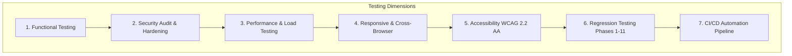

# PHASE 12 TESTING STRATEGY
## GTA 6 Player Hub – Comprehensive QA, Security & Performance Plan

### 1. Strategy Overview

This strategy outlines the verification and hardening protocols executed during Phase 12 of the GTA 6 Player Hub engineering lifecycle. The objective is to validate functional correctness, enforce cybersecurity controls, optimize database and network performance, ensure accessibility (WCAG 2.2 AA), and establish automated CI/CD gating.

---

### 2. Functional Testing Methodology

All functional requirements are verified against live backend endpoints and compiled frontend routes:
- **Home Page (`/`):** Dynamic feed aggregation, countdown clock, banner quick links, responsive navigation.
- **Gaming Community (`/community`):** Posts, comments, nested replies, likes, image attachments, polls, reports, and player blocks.
- **News & Updates (`/news`):** Filtering, verification badges (`OFFICIAL`, `VERIFIED`, `RUMOUR`, `UNCONFIRMED`), search, and bookmarking.
- **Price & Deals Tracker (`/price-deals`):** Currency localization, price drop detection, target price alerts, and wishlist tracking.
- **Events Calendar (`/events`):** Timeline views, timezone normalization, event reminder registration, and notification delivery.
- **PC Compatibility Checker (`/pc-compatibility`):** CPU/GPU validation, bottleneck guidance, and profile isolation.
- **AI Problem Solver (`/problem-solver`):** Multi-turn conversation flows, RAG knowledge grounding, 5-part structured responses, and rate limits.
- **Global Search & Saved (`/search`, `/saved`):** Command palette, category filtering, search suggestions, private history, and unified bookmark management.

---

### 3. Security Hardening & Penetration Protocols

| Security Vector | Verification Protocol | Acceptance Criteria |
| :--- | :--- | :--- |
| **Authentication & Sessions** | Bearer token validation, expired token handling, password reset token single-use. | 401 Unauthorized returned on missing/invalid tokens. |
| **Authorization & IDOR** | Attempt to modify or delete another user's profile, post, conversation, or hardware spec. | 403 Forbidden or 404 Not Found returned; strict user-level tenancy enforced. |
| **SQL Injection** | Automated fuzzing with SQL metacharacters (`' OR 1=1 --`, `UNION SELECT`) across query params. | 100% parameterization via SQLAlchemy 2.0; zero raw SQL execution. |
| **Cross-Site Scripting (XSS)** | Injection of script payloads (`<script>`, `onerror=`, `javascript:`) in community posts and search. | All content rendered safely as text; React DOM escaping and strict CSP headers. |
| **File Upload Exploits** | Upload non-image files (.exe, .php, .sh) disguised with image extensions and MIME headers. | Rejection via MIME check, extension whitelist, and binary magic byte validation. |
| **Rate Limiting & Abuse** | Execute bursts of 150+ requests per minute against `/api/v1/users/me` and search endpoints. | 429 Too Many Requests returned with `Retry-After` header when threshold exceeded. |
| **Security Headers** | Verify HTTP response headers across both FastAPI backend and Next.js frontend. | `X-Content-Type-Options: nosniff`, `X-Frame-Options: DENY`, `Strict-Transport-Security`, CSP present. |

---

### 4. Performance & Reliability Evaluation

1. **API Response Latency:** Baseline query response time < 100ms for indexed endpoints; < 250ms for complex aggregated feeds.
2. **Database Query Efficiency:** Ensure all foreign key lookups and searchable text queries utilize existing compound indexes.
3. **Frontend Bundle Size:** Maintain lightweight first-load JavaScript (< 205 kB shared).
4. **Celery Worker Idempotency:** Ensure background tasks handle unexpected worker restarts without duplicate database writes or notifications.

---

### 5. Responsive & Cross-Browser Coverage

Testing viewports:
- Mobile Small: 360px × 640px
- Mobile Standard: 390px × 844px
- Mobile Large: 430px × 932px
- Tablet Portrait: 768px × 1024px
- Tablet Landscape: 1024px × 768px
- Desktop Standard: 1280px × 800px
- Desktop Large: 1440px × 900px
- Desktop Ultra-Wide: 1920px × 1080px

Browsers: Google Chrome, Microsoft Edge, Mozilla Firefox, Apple Safari (WebKit).

---

### 6. Accessibility Target: WCAG 2.2 AA

- **Color Contrast:** Minimum 4.5:1 contrast ratio for normal body text; 3:1 for large headers and interactive buttons.
- **Keyboard Navigation:** All interactive elements focusable via `Tab` with visible focus indicators. No keyboard traps.
- **Screen Reader Support:** Semantic HTML tags (`<nav>`, `<main>`, `<header>`, `<article>`), ARIA labels on icon buttons, form label association (`htmlFor`).

---

### 7. Regression Strategy & Gating Criteria

Every defect remediated during Phase 12 must trigger a full re-run of:
1. `backend/tests/` (104+ tests).
2. Frontend lint and type checks (`npm run lint`).
3. Next.js production build (`npm run build`).
4. Automated security validation tests.
