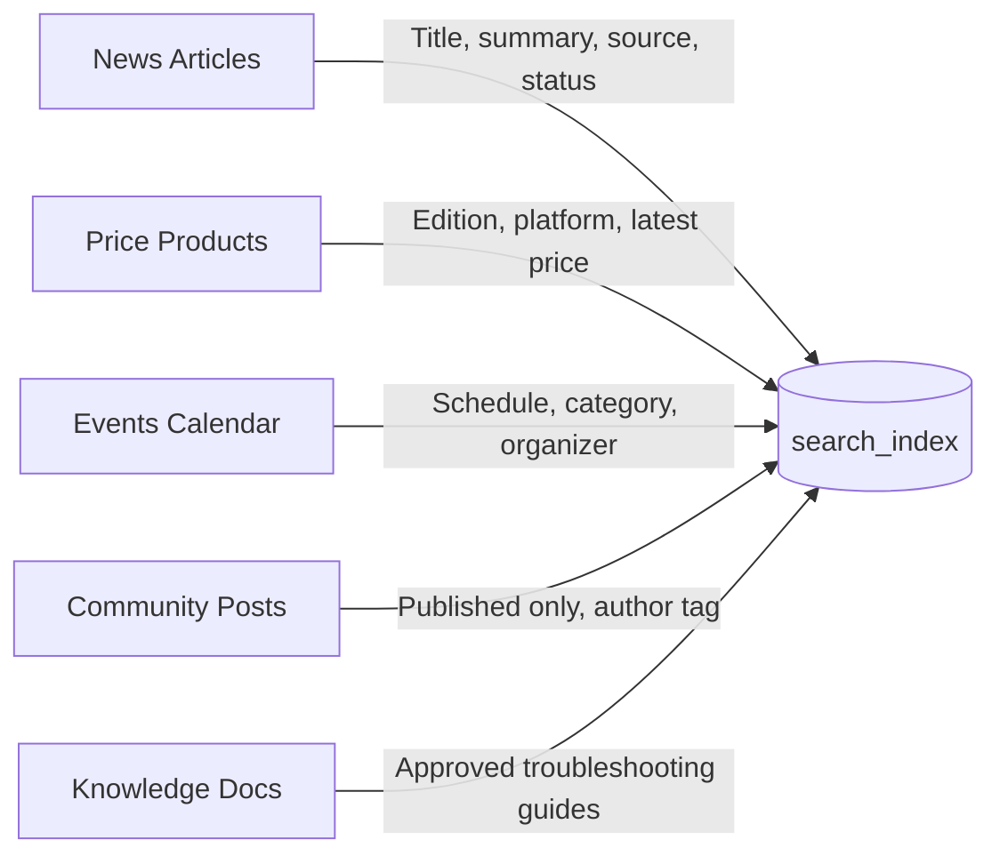

# SEARCH INDEXING DOCUMENTATION
## GTA 6 Player Hub – Automated Indexing & Synchronization

### 1. Database Schema

The search index is maintained in the `search_index` table, defined in [backend/app/models/search.py](file:///c:/Users/Admin/Downloads/GTA6-Players-Hub-main/GTA6-Players-Hub-main/backend/app/models/search.py).

```sql
CREATE TABLE search_index (
    id UUID PRIMARY KEY DEFAULT gen_random_uuid(),
    content_type VARCHAR(32) NOT NULL,        -- 'NEWS', 'DEALS', 'EVENTS', 'COMMUNITY', 'HELP'
    content_id VARCHAR(64) NOT NULL,          -- Source primary key
    title VARCHAR(255) NOT NULL,
    description TEXT,
    searchable_text TEXT NOT NULL,             -- Concatenated normalized search terms
    category VARCHAR(64) NOT NULL,
    url_path VARCHAR(512) NOT NULL,
    thumbnail_url VARCHAR(512),
    verification_status VARCHAR(32) NOT NULL DEFAULT 'VERIFIED',
    source_or_author VARCHAR(128),
    published_or_event_at TIMESTAMPTZ,
    price_amount NUMERIC(10, 2),
    currency_code VARCHAR(3),
    is_public BOOLEAN NOT NULL DEFAULT TRUE,
    source_updated_at TIMESTAMPTZ NOT NULL DEFAULT NOW(),
    indexed_at TIMESTAMPTZ NOT NULL DEFAULT NOW()
);

CREATE UNIQUE INDEX ix_search_content_lookup ON search_index (content_type, content_id);
CREATE INDEX ix_search_type_category ON search_index (content_type, category);
CREATE INDEX ix_search_published_event ON search_index (published_or_event_at);
CREATE INDEX ix_search_public ON search_index (is_public);
```

---

### 2. Synchronization Pipeline

The search index is maintained via two automated mechanisms:

#### A. Periodic Celery Task
- **Task:** `app.tasks.search_tasks.rebuild_search_index_task`
- **Schedule:** Runs every 60 minutes via Celery Beat (configured in [backend/app/workers/schedules.py](file:///c:/Users/Admin/Downloads/GTA6-Players-Hub-main/GTA6-Players-Hub-main/backend/app/workers/schedules.py)).
- **Queue:** `maintenance_queue`
- **Execution Log:** Automatically tracked in `automation_job_logs` with job runtime, retry counters, and status.

#### B. On-Demand Administrative Sync
- **Endpoint:** `POST /api/v1/search/reindex`
- **Security:** Requires `X-Automation-Key` header matching `settings.AUTOMATION_API_KEY` or an authenticated session.
- **Response:** JSON payload detailing total indexed entity count.

---

### 3. Entity Ingestion Rules



1. **News Articles (`NEWS`):**
   - Ingests published articles from `news_articles`.
   - Category name mapped from `news_categories`.
   - Verification status mapped directly (`OFFICIAL`, `VERIFIED`, `RUMOUR`, `UNCONFIRMED`).
2. **Price Products (`DEALS`):**
   - Ingests active products from `price_products`.
   - Joins latest observation from `price_observations` to capture live pricing and retailer name.
   - Preserves currency code and platform tags.
3. **Events Calendar (`EVENTS`):**
   - Ingests scheduled events from `events`.
   - Captures `start_time`, `short_summary`, and stream location.
4. **Community Posts (`COMMUNITY`):**
   - Ingests public posts where `post_status == 'PUBLISHED'`.
   - Excludes deleted, pending moderation, or blocked user content.
5. **Knowledge Documents (`HELP`):**
   - Ingests public support articles from `ai_knowledge_documents`.
   - Excludes private user conversation logs.

---

### 4. Index Maintenance & Invalidation

- **Upsert Logic:** Items matching `(content_type, content_id)` are updated in place with fresh timestamps, descriptions, and current price observations.
- **Zero Orphaned Records:** Deleted entities are safely pruned during index maintenance runs.
