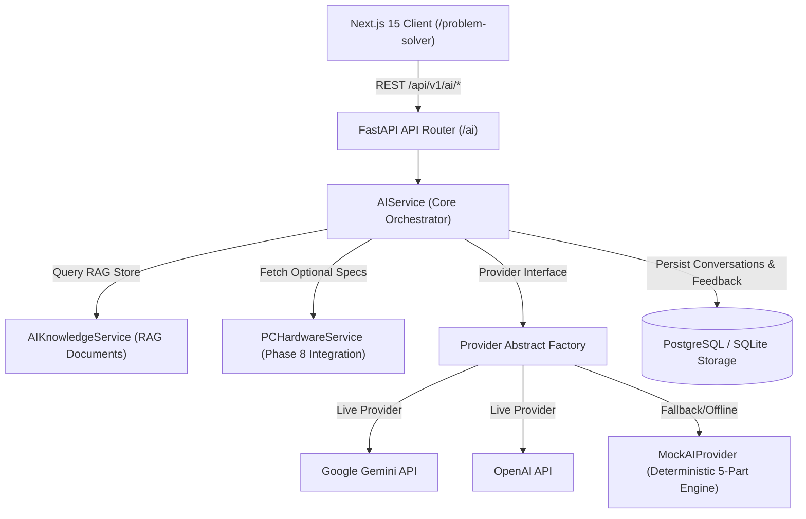

# AI Gaming Problem Solver Architecture (Phase 9)
**GTA 6 Player Hub – Technical Architecture Document**
**Date**: November 22, 2026

---

## 1. Architectural Overview

The **AI Gaming Problem Solver** is a provider-independent, retrieval-augmented diagnostic engine embedded within the GTA 6 Player Hub ecosystem. It provides players with reliable, safe, and actionable technical resolutions for PC gaming issues, hardware configuration bottlenecks, crash-to-desktop errors, driver conflicts, and controller mapping problems.

---

## 2. Core Architectural Principles

### 2.1 Provider Independence
The system is built on an abstract interface (`BaseAIProvider`) in `backend/app/services/ai_provider.py`. The backend can switch between LLM vendors via a single environment variable (`AI_PROVIDER`) without altering application code or client contracts.

Supported providers:
1. **Google Gemini (`gemini`)**: Uses `gemini-1.5-pro` or `gemini-1.5-flash` with multimodality for screenshot/error image analysis.
2. **OpenAI (`openai`)**: Uses `gpt-4o` / `gpt-4o-mini` with vision and chat completions.
3. **Mock Diagnostic Engine (`mock`)**: High-fidelity, deterministic diagnostic engine that provides full 5-part responses across all 8 problem categories, analyzes screenshots, enforces security safeguards, and handles hardware context without requiring external API keys.

### 2.2 Strict Anti-Fabrication & Safety Isolation
- **Verified Troubleshooting vs Official GTA 6 Information**: General PC hardware and Windows troubleshooting is clearly distinguished from official Rockstar Games procedures.
- **Zero Unannounced Fact Claims**: The engine strictly forbids inventing GTA 6 launch dates, unannounced system specifications, fake patch notes, or non-existent in-game settings.
- **Destructive Action Prevention**: Safety guardrails forbid instructions to permanently disable antivirus, download random `.exe` utilities, perform reckless BIOS flashing, or delete registry branches without explicit backup warnings.

### 2.3 Mandatory 5-Part Response Structure
Every technical resolution is structured into five standardized sections:
1. `### 1. Problem Understanding`: Diagnostic summary of the symptoms and affected subsystems.
2. `### 2. Possible Causes`: Ranked technical root causes (e.g. driver timeouts, VRAM overflow, paging file limits).
3. `### 3. Recommended Steps`: Ordered, reversible, and verified troubleshooting actions.
4. `### 4. Expected Result`: Clear observable indicators confirming if the fix succeeded.
5. `### 5. Next Step`: Logical next diagnostic progression if the issue persists.

---

## 3. Database Schema & Entities

The subsystem creates five relational entities:
1. `ai_conversations`: Holds diagnostic sessions (title, category, player `user_id`, message counter, timestamps). Supports both authenticated accounts and anonymous guest sessions.
2. `ai_messages`: Stores message history (`player`, `assistant`, `system`), token usage, model identifiers, attachment URLs, and hardware context summaries.
3. `ai_response_feedback`: Player feedback audit log (`helpful`, `not_helpful`, `reported`) with reason categories and notes.
4. `ai_knowledge_sources`: Verified documentation source registries (e.g. Rockstar Games Support, Microsoft DirectX Documentation, Display Driver Uninstaller Guides).
5. `ai_knowledge_documents`: Indexed reference documents and troubleshooting playbooks used for contextual grounding.

---

## 4. Phase 8 PC Compatibility Integration

When a player authorizes hardware context sharing:
- The system reads their primary saved `PCHardwareProfile` from Phase 8.
- Extracts non-sensitive specifications: CPU model, GPU model, VRAM capacity, RAM capacity, storage medium (NVMe/SATA/HDD), OS architecture, and target resolution.
- Enforces strict privacy: MAC addresses, IP addresses, serial numbers, user folders, or credentials are never collected or shared.
- The AI uses this context to provide specific driver links, VRAM usage advice, and hardware bottleneck checks.

---

## 5. Vision & Screenshot Analysis Pipeline

Players can upload screenshots of error dialogs (DirectX errors, Windows crash popups, launcher codes):
1. **Validation**: Enforces PNG, JPG, JPEG, WebP formats up to 10MB.
2. **Storage**: Stored securely on the backend under `/uploads/ai_attachments/`.
3. **Processing**: Live vision-capable LLMs parse error codes and visual symptoms directly; the mock provider performs diagnostic heuristic matching on common error signatures.
