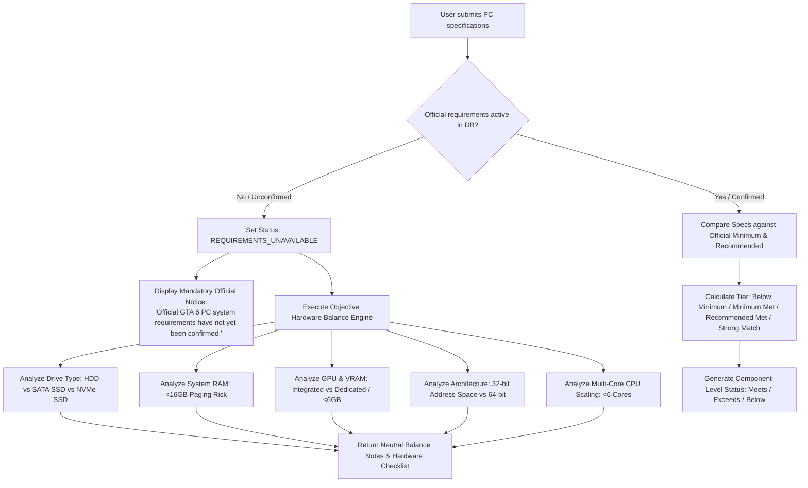

# GTA 6 Player Hub – PC Compatibility Checker Architecture

## 1. System Overview

The **PC Compatibility Checker** (Phase 8) provides a data-driven, truth-verified hardware evaluation and diagnostics engine for players preparing their personal computers for *Grand Theft Auto VI*.

### Core Principles
1. **Critical Anti-Fabrication Mandate**: Rockstar Games has not yet confirmed official PC system requirements for GTA 6. When official requirements are unconfirmed, the platform strictly disallows synthetic pass/fail labels, fabricated FPS predictions, speculative requirements masquerading as fact, or arbitrary bottleneck percentages.
2. **Objective Hardware Balance Analysis**: When official specifications are pending, the engine evaluates submitted user specifications against contemporary AAA gaming baselines (DirectX 12 / Vulkan low-overhead APIs, high-speed NVMe asset streaming, 16GB+ RAM allocation, multi-core CPU scaling).
3. **Player Profile Isolation**: Authenticated players can save multiple PC hardware profiles, designate a primary rig, re-test with one click, and review diagnostic history. Anonymous visitors can evaluate specifications freely without forced registration.
4. **Independent Upgrade Guidance**: Delivers neutral physical and electrical upgrade checklists (motherboard sockets, chipset tiers, BIOS firmware, RAM generations, GPU dimensions, and PSU wattage). Strictly zero commercial marketplace or affiliate shopping integrations.

---

## 2. Component Architecture

```
┌─────────────────────────────────────────────────────────────┐
│                       Frontend (Next.js)                    │
│  ┌───────────────────────────────────────────────────────┐  │
│  │   PCCompatibilityPage (/pc-compatibility)             │  │
│  │   ├── RequirementsStatusCard (Verification & Notice)  │  │
│  │   ├── HardwareInputForm (Manual & Preset Rigs)        │  │
│  │   ├── HardwareSummaryCard (Structured Rig Specs)      │  │
│  │   ├── CompatibilityResultSection (Diagnostics Engine) │  │
│  │   ├── HardwareBottleneckAnalysis (Balance Notes)      │  │
│  │   ├── UpgradeGuidanceSection (Hardware Checklist)     │  │
│  │   ├── SavedPCProfilesModal (Player Account Rigs)      │  │
│  │   └── CompatibilityHistoryModal (Audit & History)     │  │
│  └───────────────────────────────────────────────────────┘  │
└──────────────────────────────┬──────────────────────────────┘
                               │ HTTP / REST API (JWT Optional)
┌──────────────────────────────▼──────────────────────────────┐
│                    FastAPI Backend Service                  │
│  ┌───────────────────────────────────────────────────────┐  │
│  │   PC Compatibility Router (/api/v1/pc/*)              │  │
│  │   ├── GET /requirements/status                        │  │
│  │   ├── GET /requirements                               │  │
│  │   ├── GET, POST, PUT, DELETE /profiles                │  │
│  │   ├── POST /compatibility/check                       │  │
│  │   └── GET /compatibility/history                      │  │
│  └───────────────────────────┬───────────────────────────┘  │
│                              │                              │
│  ┌───────────────────────────▼───────────────────────────┐  │
│  │   PC Compatibility Service Layer                      │  │
│  │   ├── Official Requirements Status Verifier           │  │
│  │   ├── Hardware Profile CRUD & Ownership Isolation     │  │
│  │   ├── Balance & Architectural Bottleneck Analyzer     │  │
│  │   └── Diagnostics & Check History Logger              │  │
│  └───────────────────────────────────────────────────────┘  │
└──────────────────────────────┬──────────────────────────────┘
                               │ SQLAlchemy Async / PostgreSQL
┌──────────────────────────────▼──────────────────────────────┐
│                 PostgreSQL / Supabase Database              │
│  ├── pc_hardware_profiles (User PC specifications)          │
│  ├── game_system_requirements (Official spec repository)    │
│  └── pc_compatibility_checks (Historical check records)     │
└─────────────────────────────────────────────────────────────┘
```

---

## 3. Truth Verification Workflow



---

## 4. Security & Data Isolation
- **Row-Level Security (RLS)**: Enforced via Supabase RLS policies and backend service ownership verification (`user_id == current_user.id`).
- **Anonymous Safe Mode**: Anonymous visitors execute checks with `user_id = None`. No cross-user access to profile data or history.
- **Input Sanitization & Validation**: Pydantic v2 schemas enforce boundaries (RAM 2–512 GB, VRAM 0.5–96 GB, Cores 1–128, non-negative storage capacities).
